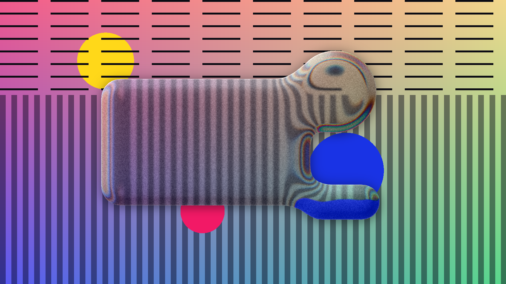

# Liquid Glass for Photoshop and Illustrator: Sudo Liquid Glass (Apple iOS 26 glass effect plugin)

**Stop faking glass. Make it real, keep it live.**

You know the routine. Merge a copy of the background, blur it, clip it to a shape, paint in some highlights, and it looks… fine. Then the client moves one element and you get to do it all again.

**Sudo Liquid Glass** is a free, open-source plugin for **Photoshop** and **Illustrator** that turns your own shapes and text into real, live glass in one click. It's Apple's **Liquid Glass** look from iOS 26 and macOS Tahoe, with true refraction. Nothing gets merged or flattened, and it re-renders whenever anything changes.

> One click. Real refraction. Zero flattened layers.



**Download:** [latest release](../../releases/latest)
- **Photoshop** 2023 (v24.2) or newer: `SudoLiquidGlass.ccx`, Windows and macOS (Intel and Apple Silicon).
- **Illustrator** 2026 on Windows: `LiquidGlass.aip` inside the installer zip.

> **Honest status:**
> - Photoshop and Illustrator are tested on Windows.
> - The Photoshop package has no platform-specific code, but it hasn't been tested on a Mac yet. If you try it, please [open an issue](../../issues).
> - **Illustrator is Windows only.** A Mac build needs Xcode on a Mac and isn't made yet.
> - The images here are renders from the plugin's own engine on test shapes, not app screenshots. Real screenshots and a demo video are coming.

## Why designers switch
- **"I re-did that glass five times today."** The glass reads what's behind it on every change. Move the photo, edit the text, nudge the shape: the glass catches up by itself.
- **"Glassmorphism always looks flat."** Real glass *bends* light. The rim refracts what's behind it, splits it into a subtle rainbow, and catches the light like an embossed edge, the way Apple's Liquid Glass does.
- **"Merging layers wrecks my file."** Your shapes and text stay fully editable. Undo, re-edit, and hand the file off without fear.
- **"I just want the frosted look, fast."** Pick a look (Frosted, Glassmorphism, Ice, Smoked, Crystal, Bubble…), then fine-tune it with four sliders that are always on screen.

## Features
- **One click, non-destructive:** works on your shape and text layers (Photoshop) or any shape, group or text as a live effect (Illustrator).
- **Live updates:** move, resize or reshape the glass, edit the text, or change anything behind it, and the glass re-renders.
- **Looks:** Liquid Glass, Clear, Frosted, Glassmorphism, Ice, Smoked, Crystal, Bubble and Film frost, each with a preview card. **Save your own looks** and use them in every document.
- **Quick controls:** Frost, Lens, Edge width and Shine stay on screen, so any look is one drag away from yours.
- **Exact outlines:** rectangles, ellipses, Pen paths, combined shapes, and the letter outlines of **text**. In Illustrator, strokes and variable-width profiles become glass too.
- **Liquid merge:** several shapes melt together, growing liquid bridges with rounded inner corners.
- **Real optics:** lens refraction, light dispersion (rainbow edge), frost, vividness, tint, two rim lights with a direction dial, and a bevel/emboss.
- **Advanced controls:** emboss, rim line, glass type (index of refraction from air to diamond) and sheen.
- **Inner glow** with colour and blend modes (Normal, Screen, Overlay, Soft light, Add, Multiply).
- **Stroke** just inside the edge, in a solid colour or a gradient that can fade away.
- **Drop shadow** and **Dim background**, each with an on/off switch.
- **Film grain by film format:** monochrome grain sized from Super 8 to 4×5 large format.
- **Explained in plain words:** every setting has a small icon and a hover explanation.
- **Fast:** the renderer is written in **Rust** (WebAssembly in Photoshop, native in Illustrator).

## Install
**Photoshop (Windows and macOS):**
1. Download `SudoLiquidGlass.ccx` from the [latest release](../../releases/latest).
2. Double-click it. The Creative Cloud desktop app installs the plugin.
3. Restart Photoshop and open **Plugins › Sudo Liquid Glass**.

**Illustrator (Windows):**
1. Download `SudoLiquidGlass-…-installer.zip` from the [latest release](../../releases/latest) and unzip it.
2. Close Illustrator, then double-click **`Install Illustrator on Windows.bat`** and allow it to make changes.
3. Start Illustrator, select a shape and choose **Effect › Stylize › Liquid Glass…**.

The same zip has one-click Photoshop installers too: `Install Photoshop on Windows.bat` and `Install Photoshop on Mac.command` (if macOS blocks it, right-click › Open).

**Why `.ccx` and not `.zxp`?** ZXP is the package format for Adobe's older CEP extensions. The Photoshop plugin is a modern UXP plugin, and Adobe packages those as `.ccx`, the same format its own plugin marketplace uses. The Illustrator plugin is a native `.aip` plug-in.

## How to use
**Photoshop**
1. Draw shapes with a Shape tool or the Pen tool in Shape mode, or type some text.
2. Select those layers and click **Make Glass**.
3. Pick a look, fine-tune with the quick sliders, and explore the tabs:

| Tab | Controls |
|---|---|
| **Glass** | edge softness, dispersion, merge; **Advanced:** emboss, rim line, glass type, sheen |
| **Light** | light direction dial, brightness, vividness, tint |
| **Shadow** | drop shadow; dim background |
| **Finish** | inner glow, stroke, film grain, edge effects (Layer Styles) |

- **Adding more:** select the glass plus the new layers and click **Make Glass**, or drag them into the glass group.
- **Moving:** move your shapes or the whole group. Leave the `◆ glass render (automatic)` folder alone; the plugin manages it.
- **Pixel layers** can't become glass. Use a shape or text layer.

**Illustrator**
1. Select a shape, group or text and choose **Effect › Stylize › Liquid Glass…**.
2. Pick a look and adjust it in the settings window; **Preview** shows changes on the artboard.
3. To change it later, double-click **Liquid Glass** in the Appearance panel, or use **Object › Edit Liquid Glass…** (you can give it a shortcut in Edit › Keyboard Shortcuts).
4. **Object › Refresh All Liquid Glass** re-reads the background of every glass. The glass also refreshes by itself when the art behind it changes.

Liquid Glass refuses things that can't work and tells you why: pixel images, groups that contain an image, and a second Liquid Glass on the same object.

## How to make Apple's Liquid Glass effect in Photoshop or Illustrator
Without a plugin, you blur a merged copy of the background, clip it to a shape, and add bevels and highlights by hand. That's a static fake, and it breaks the moment anything moves. Sudo Liquid Glass computes real refraction from the live artwork behind your shape and keeps it up to date.

## Roadmap
- [x] **Photoshop** (Windows and macOS): available
- [x] **Illustrator** (Windows): available
- [ ] **Illustrator for Mac**: planned (needs a Mac build)
- [ ] **After Effects** and **Premiere Pro**: planned, not started
- [ ] GPU rendering, linear-light blending, light/dark adaptive tint

## How it works
```
core/        Rust renderer (glass_core): backdrop + shape masks → glass layer + shadow layer
photoshop/   UXP plugin: panel, live updates, vector and text outline reader, WebAssembly bridge;
             looks.js (defaults, looks and icons) is shared with Illustrator
illustrator/ native Live Effect (C++, Illustrator SDK) with a WebView2 settings window
installer/   one-click installers shipped in the release zip
preview/     renders the preview images from test shapes
docs/        full project history and handoff notes
```
1. Each shape becomes a signed distance field. Several shapes join through a smooth union, which makes the liquid merge.
2. A squircle bevel gives surface normals. Those drive Snell refraction with per-channel dispersion, then bevel shading, rim lights, inner glow and stroke.
3. The refracted backdrop is frosted, colour-graded and tinted. The shadow and dim halo go on their own layer.
4. Photoshop reads the backdrop inside a history step that it rolls back; Illustrator rasterizes the art below the glass. Your document is never changed by a read.

Working on the code, or pointing an AI coding agent at it? Start with [AGENTS.md](AGENTS.md) and [docs/PROJECT_HISTORY.md](docs/PROJECT_HISTORY.md).

## Build from source
Needs [Rust](https://rustup.rs) and Node.js. Run `rustup target add wasm32-unknown-unknown` once.
```bash
npm install
```
```bash
npm test
```
**Photoshop:** after changing the engine, rebuild it and copy `target/wasm32-unknown-unknown/release/glass_core.wasm` into `photoshop/`:
```bash
cargo build -p glass_core --release --target wasm32-unknown-unknown
```
Package as `dist/SudoLiquidGlass.ccx` and install with `powershell -ExecutionPolicy Bypass -File install.ps1` (Windows) or `sh install.sh` (macOS). Add `-NoInstall` / `--no-install` to only build the package.

**Illustrator (Windows):** needs Visual Studio C++ Build Tools, the [Illustrator SDK](https://developer.adobe.com/console) and the Microsoft.Web.WebView2 NuGet package. See [illustrator/README.md](illustrator/README.md).

## Known limits
- RGB documents only in Photoshop; Illustrator works in RGB and warns in CMYK documents.
- Photoshop updates land when you release the mouse: Photoshop doesn't run plugins mid-drag.
- Each live update in Photoshop is a history step, so undoing an edit takes two steps.
- Brush strokes in Photoshop don't trigger an update: press **Refresh**.

## About
Made by **CGSudo**. [Connect on LinkedIn](https://www.linkedin.com/in/cgsudo).

## License
[MIT](LICENSE) © CGSudo. Not affiliated with Apple or Adobe. "Liquid Glass" refers to Apple's design material; Photoshop and Illustrator are trademarks of Adobe.
