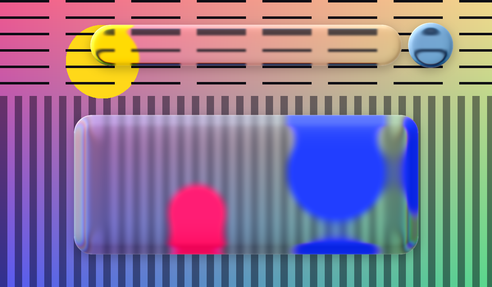

# Liquid Glass for Photoshop: Sudo Liquid Glass plugin (Apple iOS 26 glass effect)

**Sudo Liquid Glass** is a free, open-source **Photoshop plugin** that recreates Apple's **Liquid Glass** effect from iOS 26 and macOS Tahoe. Turn your own shape layers into real, live, refracting glass in one click, like the glass effect in Figma. It runs on Windows and macOS.

- Not a fake glassmorphism blur: the edges bend light (Snell refraction) and split it into a rainbow (dispersion).
- No merging or flattening layers.
- It updates live when you move or edit anything.



*Engine test render on a synthetic test pattern, not a Photoshop screenshot. Real Photoshop screenshots and a demo video are coming.*

**Download:** [latest release (SudoLiquidGlass.ccx)](../../releases/latest) · Photoshop 2023 (v24.2) or newer · Windows and macOS (Intel and Apple Silicon)

> **Platform status:** tested in Photoshop on Windows. The macOS build is the same package with no platform-specific code, but it hasn't been tested on a Mac yet. If you try it on a Mac, please [open an issue](../../issues) with the result.

## Features
- **One click, non-destructive:** select shape layers and click **Make Glass**. Your shapes stay fully editable vector layers.
- **Live updates:** move, resize or reshape the glass, or anything behind it, and it re-renders by itself.
- **Exact shape:** rectangles, rounded rectangles, ellipses and any Pen tool path, including combined shapes (add, subtract, intersect, exclude).
- **Liquid merge:** several shapes in one glass melt together. Where they come close they grow a liquid bridge and the inner corners round off, like Apple's morphing glass.
- **Real optics:**
  - lens refraction at the rim (index of refraction 1.5),
  - chromatic dispersion,
  - frosted blur,
  - vividness and tint,
  - two rim lights with a light direction dial.
- **Shadow and Dim background:** a soft drop shadow, plus an optional dimming halo that keeps glass legible on busy photos.
- **Film grain:** grain sized by film format: Super 8, 16 mm, 35 mm, 6×6 medium format, 4×5 large format.
- **Edge effects with Layer Styles:** the glass layer is exactly your shape, so Photoshop's own strokes (solid or gradient), glows and shadows trace it and stack.
- **Fast:** the renderer is written in **Rust** and runs as **WebAssembly**. A 1000×1000 glass renders in about 0.3 s.

## Install (Windows and macOS)
1. Download `SudoLiquidGlass.ccx` from the [latest release](../../releases/latest).
2. Double-click it. The Creative Cloud desktop app opens and installs the plugin.
3. Restart Photoshop and open **Plugins › Sudo Liquid Glass**.

If double-clicking doesn't install it, install from the command line with Adobe's own installer (Creative Cloud must be installed):
- **macOS:**
  ```bash
  "/Library/Application Support/Adobe/Adobe Desktop Common/RemoteComponents/UPI/UnifiedPluginInstallerAgent/UnifiedPluginInstallerAgent.app/Contents/MacOS/UnifiedPluginInstallerAgent" --install ~/Downloads/SudoLiquidGlass.ccx
  ```
- **Windows** (Command Prompt):
  ```bat
  "C:\Program Files\Common Files\Adobe\Adobe Desktop Common\RemoteComponents\UPI\UnifiedPluginInstallerAgent\UnifiedPluginInstallerAgent.exe" /install %USERPROFILE%\Downloads\SudoLiquidGlass.ccx
  ```

**Why `.ccx` and not `.zxp`?** ZXP is the package format of Adobe's older CEP extensions. Sudo Liquid Glass is a modern UXP plugin, and Adobe packages those as `.ccx`, the same format its own plugin marketplace uses.

## How to make Apple's Liquid Glass effect in Photoshop
Without a plugin, the usual approach is a blurred, merged copy of the background clipped to a shape, plus bevels and highlights. That's a static glassmorphism fake, and it breaks as soon as anything moves. Sudo Liquid Glass computes real refraction from the layers behind your shape and keeps it live.

## How to use
1. Draw shapes with a Shape tool, or with the Pen tool in Shape mode.
2. Select one or more shape layers and click **Make Glass**.
3. Change the look in the panel's tabs:

| Tab | Controls |
|---|---|
| **Glass** | Regular / Clear look, lens strength, edge thickness, edge curve, rainbow edge, blur, merge distance |
| **Light** | light direction dial, intensity, brightness, vividness, tint colour and strength |
| **Shadow** | drop shadow opacity, softness, distance; Dim background on/off, intensity, halo reach |
| **Finish** | film grain on/off, film format, intensity, grain size; strokes, glows and shadows |

- To add shapes to an existing glass, select the glass plus the new shapes, then click **Make Glass**.
- Plain pixel layers can't become glass: use a shape layer.

## Roadmap
**Today Sudo Liquid Glass is for Photoshop only.** Other apps are plans, not releases:
- [x] **Photoshop**: available now (this repo)
- [ ] **Illustrator**: planned; in early development, not released
- [ ] **After Effects** and **Premiere Pro**: planned, not started
- [ ] GPU rendering, linear-light blending, light/dark adaptive tint

## How it works
```
core/        Rust renderer (glass_core): backdrop + shape masks → glass layer + shadow layer
photoshop/   UXP plugin: panel, live updates, vector path reader, WebAssembly bridge
preview/     renders the preview images from a test backdrop
```
1. Each shape becomes a signed distance field with a squircle bevel.
2. Several shapes join through a smooth union, which makes the liquid merge.
3. Surface normals drive Snell refraction, with per-channel dispersion.
4. The refracted backdrop is frosted, colour-graded and tinted.
5. Rim lights, the shadow and the film grain are added on top.
6. To read the backdrop, the plugin hides the glass and everything above it inside a Photoshop history step, then rolls that step back, so your document is never changed by a read.
7. Settings are stored in the glass layer's name, so they survive saving and opening the file on other machines.

Working on the code, or pointing an AI coding agent at it? Start with [AGENTS.md](AGENTS.md).

## Build from source
Needs [Rust](https://rustup.rs) and Node.js. Run `rustup target add wasm32-unknown-unknown` once.
```bash
cargo test -p glass_core
```
```bash
cargo build -p glass_core --release --target wasm32-unknown-unknown
```
Copy `target/wasm32-unknown-unknown/release/glass_core.wasm` into `photoshop/`, then run the plugin tests:
```bash
node photoshop/engine.test.js
```
```bash
node photoshop/paths.test.js
```
To load it unpackaged, add `photoshop/manifest.json` in Adobe's **UXP Developer Tool**. To package it as `dist/SudoLiquidGlass.ccx` and install it:
- **Windows:**
  ```bash
  powershell -ExecutionPolicy Bypass -File install.ps1
  ```
- **macOS:**
  ```bash
  sh install.sh
  ```

Add `-NoInstall` (Windows) or `--no-install` (macOS) to only build the package.

## Known limits
- RGB documents only.
- Updates land when you release the mouse: Photoshop doesn't run plugins mid-drag.
- Each live update is a history step, so undoing an edit takes two steps.
- Brush strokes don't trigger an update: press **Refresh**.

## License
[MIT](LICENSE) © CGSudo. Not affiliated with Apple or Adobe. "Liquid Glass" refers to Apple's design material; Photoshop is a trademark of Adobe.
